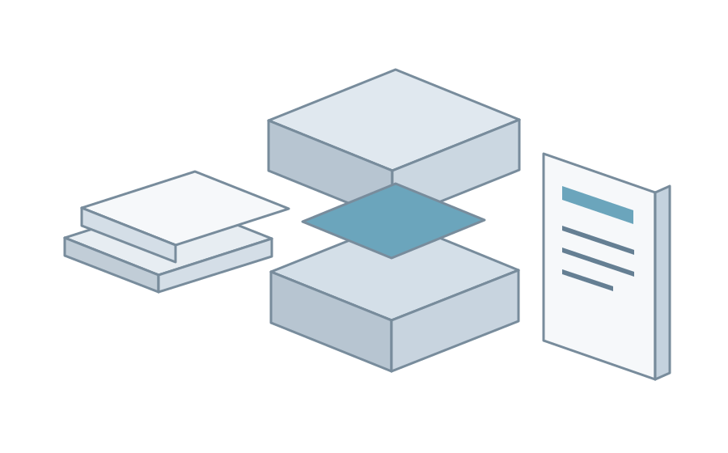
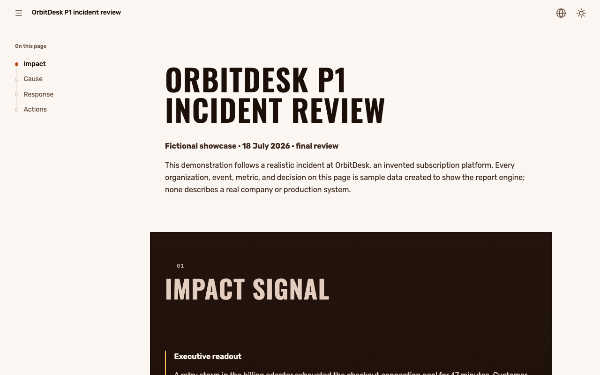
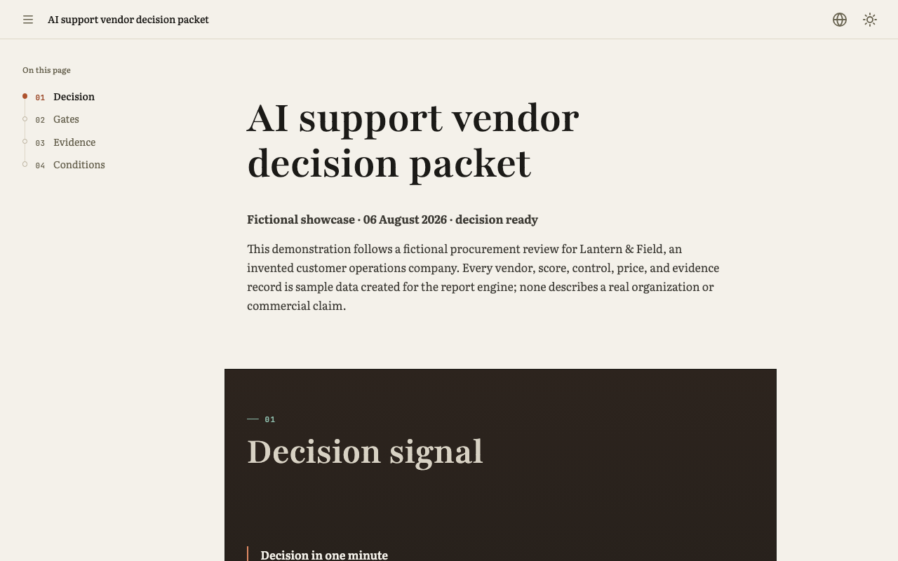

# Give your findings a page.

Agentic Report turns Markdown into interactive pages a reader can inspect and comment on.

```sh
npx skills add witqq/agentic-report --skill agentic-report
```

::::actions{placement="edge"}
::action[Make your first page]{href="#start" kind="primary"}
::action[Inspect a working result]{href="#result" kind="quiet"}
::::

:::::section{title="From source to page" id="core" nav="The mechanism" place="opening" recipe="demo" frame="none" transition="staged" media="natural" execution-core="report"}

::::actions{placement="inline"}
::action[Markdown]{href="#result" kind="quiet"}
::action[Compiler]{href="#compile" kind="quiet"}
::action[HTML page]{href="#result" kind="quiet"}
::::

{dark="assets/compile-core-dark.svg"}

_Compilation model, not hardware or a recorded run._

:::::

::::::section{title="Keep the source. Build the page." id="compile" nav="Source to page" composition="flow" scene="steps" media="natural" execution-core="report"}

{dark="assets/compile-core-dark.svg"}

_The original source stays in place while its values enter the core and a page emerges._

:::beat{title="Write what you know" state="compile-input"}
Markdown holds the explanation. Local JSON supplies the figures; assets, shared partials and YAML/JSON
theme data stay with the source.
:::

:::beat{title="Build from that source" state="compile-process"}
The compiler checks the format and file boundaries before writing the result. The author checks the
claims. Custom code enters through explicitly declared extensions.
:::

:::beat{title="Give the reader a working page" state="compile-output"}
The default result is one HTML file that opens from disk. Figures have native controls; text can carry
review notes. Directory output keeps separate assets when a larger page needs them.
:::

::::::

:::::::section{title="Open the evidence" id="result" nav="Working result" composition="flow" width="reading"}

This is a native figure built from the data below. Open it, inspect the values, then return to the page.

::expect{data="incident.points" count="5"}

::::chart{type="line" title="Failed checkout attempts" description="Fictional OrbitDesk checkout failure rates at five UTC checkpoints." x-label="UTC checkpoint" y-label="Failed attempts, percent"}
:::series{label="Failure rate"}
::point{label="{{incident.points.0.utc}}" value="{{incident.points.0.percent}}"}
::point{label="{{incident.points.1.utc}}" value="{{incident.points.1.percent}}"}
::point{label="{{incident.points.2.utc}}" value="{{incident.points.2.percent}}"}
::point{label="{{incident.points.3.utc}}" value="{{incident.points.3.percent}}"}
::point{label="{{incident.points.4.utc}}" value="{{incident.points.4.percent}}"}
:::
::::

::source-line[Five UTC checkpoints from the fictional OrbitDesk incident. Example checkout failure rates, not Report performance metrics.]{date="{{incident.date}}"}

:::::disclosure{title="Read the Markdown that builds this figure" open="false"}

```md
::::chart{type="line" title="Failed checkout attempts" description="Fictional OrbitDesk checkout failure rates at five UTC checkpoints." x-label="UTC checkpoint" y-label="Failed attempts, percent"}
:::series{label="Failure rate"}
::point{label="{{incident.points.0.utc}}" value="{{incident.points.0.percent}}"}
::point{label="{{incident.points.1.utc}}" value="{{incident.points.1.percent}}"}
::point{label="{{incident.points.2.utc}}" value="{{incident.points.2.percent}}"}
::point{label="{{incident.points.3.utc}}" value="{{incident.points.3.percent}}"}
::point{label="{{incident.points.4.utc}}" value="{{incident.points.4.percent}}"}
:::
::::
```

:::::

Tables, diagrams and local media use the same theme. The original Markdown remains the source for the
next revision.

:::::::

::::section{title="Put the question beside the passage" id="notes" nav="Reader notes" composition="flow" tone="contrast"}

Select this sentence and choose **Create note**: every decision should make its supporting evidence
possible to check.

Continue the thread, resolve the question, then export `review.json` when you want to return the
discussion to the author. Feedback is not sent automatically. This built page stores local notes;
it does not connect to Codex.

::::

:::::section{title="Revise with the conversation already doing the work" id="live" nav="Local discussion" composition="flow" width="reading"}

For a living document, run the local reader from the Codex conversation writing that source:

```sh
npx --yes agentic-report@0.21.1 serve ./my-page --human
```

Open the printed localhost address. Select a passage and choose **Ask agent**. The reply streams into
the chat; source edits rebuild the page and highlight what changed. By default this connects to the
current loaded, writable Codex conversation through its compatible local control endpoint.

`serve` is an opt-in, single-user local reader. It does not publish the conversation as a hosted
service. Live discussion controls currently use English. A separate agent requires an explicit choice.

:::::

:::::section{title="Follow a real task through the page" id="examples" nav="Examples" composition="flow"}

The organizations and evidence in these maintained examples are fictional. Their page layouts and
interactions are actual package output.

::::cards
:::card{title="Incident review" href="examples/incident-review/index.html"}
Impact, contributing causes, recovery checkpoints and follow-up actions share one report.
:::
:::card{title="Vendor decision" href="examples/vendor-decision/index.html"}
Conditions and evidence support a recommendation, including what would change it.
:::
:::card{title="Architecture" href="examples/architecture/index.html"}
A system map sits beside alternatives and the rollout that follows the decision.
:::
::::

The [capability tour](examples/capability-tour/index.html) pairs working
techniques with Markdown. The [visual catalogue](examples/visual-catalog/index.html)
shows complete compositions.

::::disclosure{title="Browse all examples and their sources" open="false"}

These are real captures of maintained examples in both colour schemes.

{dark="assets/incident-review-dark.png"}

{dark="assets/vendor-decision-dark.png"}

{dark="assets/launch-readiness-dark.png"}

| Reader task           | Working page                                      | Authored source                                      |
| --------------------- | ------------------------------------------------- | ---------------------------------------------------- |
| Decision report       | [Open](examples/document/index.html)              | [Markdown](examples/document/report.md)              |
| Research              | [Open](examples/research/index.html)              | [Markdown](examples/research/report.md)              |
| Architecture          | [Open](examples/architecture/index.html)          | [Markdown](examples/architecture/report.md)          |
| First-page tutorial   | [Open](examples/tutorial/index.html)              | [Markdown](examples/tutorial/report.md)              |
| Dashboard             | [Open](examples/dashboard/index.html)             | [Markdown](examples/dashboard/report.md)             |
| Landing starter       | [Open](examples/landing/index.html)               | [Markdown](examples/landing/report.md)               |
| Visual catalogue      | [Open](examples/visual-catalog/index.html)        | [Markdown](examples/visual-catalog/report.md)        |
| Interactive catalogue | [Open](examples/interactive-catalog/index.html)   | [Markdown](examples/interactive-catalog/report.md)   |
| Visualization atlas   | [Open](examples/visualization-catalog/index.html) | [Markdown](examples/visualization-catalog/report.md) |
| Terminal portfolio    | [Open](examples/terminal-portfolio/index.html)    | [Markdown](examples/terminal-portfolio/report.md)    |
| Cinematic story       | [Open](examples/cinematic-story/index.html)       | [Markdown](examples/cinematic-story/report.md)       |
| Executive brief       | [Open](examples/executive-brief/index.html)       | [Markdown](examples/executive-brief/report.md)       |
| Motion and depth      | [Open](examples/motion-showcase/index.html)       | [Markdown](examples/motion-showcase/report.md)       |
| Run report from data  | [Open](examples/run-report/index.html)            | [Markdown](examples/run-report/report.md)            |
| Capability tour       | [Open](examples/capability-tour/index.html)       | [Markdown](examples/capability-tour/report.md)       |
| Incident review       | [Open](examples/incident-review/index.html)       | [Markdown](examples/incident-review/report.md)       |
| Vendor decision       | [Open](examples/vendor-decision/index.html)       | [Markdown](examples/vendor-decision/report.md)       |
| Launch readiness      | [Open](examples/launch-readiness/index.html)      | [Markdown](examples/launch-readiness/report.md)      |
| Code review           | [Open](examples/code-review/index.html)           | [Markdown](examples/code-review/report.md)           |
| A question to answer  | [Open](examples/answer/index.html)                | [Markdown](examples/answer/report.md)                |
| Presentation          | [Open](examples/presentation/index.html)          | [Markdown](examples/presentation/report.md)          |
| Open questions        | [Open](examples/question-review/index.html)       | [Markdown](examples/question-review/report.md)       |

[Review workspace](examples/review-workspace/index.html) ·
[Review source](examples/review-workspace/report.md) ·
[Prior review example](examples/review-workspace/prior-review.json) ·
[Structured Response](examples/response-workspace/index.html) ·
[Packaged example manifest](examples/manifest.json)

::::

:::::

::::::section{title="Give your agent the material" id="start" nav="Build your page" composition="flow" width="reading"}

Install the skill with the command at the top, then give your agent the real notes and evidence.

:::copyable
Use agentic-report to turn these incident notes into a report. Show the timeline and the evidence behind
the decision. Let me comment on passages, and inspect the finished page on mobile and desktop.
:::

:::::disclosure{title="Build directly from the command line" open="false"}
Use Node.js 24.18.0 or newer. The first invocation needs access to the npm registry.

```sh
npx --yes agentic-report@0.21.1 init ./my-page --starter document --json
npx --yes agentic-report@0.21.1 build ./my-page --output ./my-page.html --json
```

Edit `my-page/report.md` between the commands. Open the resulting HTML directly from disk; it needs no
development server. `build` validates the source before writing the result.
:::::

The [source contract](docs/product/source-contract.md) describes the
authoring boundary. The [agent guide](docs/agent/index.html) explains the page-making
workflow.

:::actions{placement="bottom"}
::action[Read the agent guide]{href="docs/agent/index.html" kind="primary"}
::action[Project source]{href="https://github.com/witqq/agentic-report" kind="quiet"}
:::

::::::

::::::section{title="Keep the source within reach" id="resources" nav="Resources" composition="flow" width="reading"}

[Human guide](docs/index.html) · [Agent quickstart source](docs/agent/index.md) ·
[Exact skill](skills/agentic-report/SKILL.md) · [Landing starter source](source/starter/landing/report.md) ·
[Public route manifest](website/routes.json) · [Release identity](release.json)

The ordinary source format keeps remote fetching, raw HTML and implicit code execution outside its boundary.
Declared extensions carry their own trust contract. Hosted collaboration, PDF export, pagination and
disabled-JavaScript parity are outside the product.

:::::disclosure{title="Download this page's complete source graph" open="false"}
The two namespaces expose the same original files. Preserve the relative paths when saving an entry,
its Russian variant, local data, images and the declared extension. The model code carries its MIT notice.

| File                                                     | Source namespace                                                                  | Canonical namespace                                                                |
| -------------------------------------------------------- | --------------------------------------------------------------------------------- | ---------------------------------------------------------------------------------- |
| `report.md`                                              | [Download](source/landing/report.md)                                              | [Download](website/landing/report.md)                                              |
| `report.ru.md`                                           | [Download](source/landing/report.ru.md)                                           | [Download](website/landing/report.ru.md)                                           |
| `data/incident.json`                                     | [Download](source/landing/data/incident.json)                                     | [Download](website/landing/data/incident.json)                                     |
| `assets/compile-core.svg`                                | [Download](source/landing/assets/compile-core.svg)                                | [Download](website/landing/assets/compile-core.svg)                                |
| `assets/compile-core-dark.svg`                           | [Download](source/landing/assets/compile-core-dark.svg)                           | [Download](website/landing/assets/compile-core-dark.svg)                           |
| `assets/social-preview.png`                              | [Download](source/landing/assets/social-preview.png)                              | [Download](website/landing/assets/social-preview.png)                              |
| `assets/incident-review.png`                             | [Download](source/landing/assets/incident-review.png)                             | [Download](website/landing/assets/incident-review.png)                             |
| `assets/incident-review-dark.png`                        | [Download](source/landing/assets/incident-review-dark.png)                        | [Download](website/landing/assets/incident-review-dark.png)                        |
| `assets/vendor-decision.png`                             | [Download](source/landing/assets/vendor-decision.png)                             | [Download](website/landing/assets/vendor-decision.png)                             |
| `assets/vendor-decision-dark.png`                        | [Download](source/landing/assets/vendor-decision-dark.png)                        | [Download](website/landing/assets/vendor-decision-dark.png)                        |
| `assets/launch-readiness.png`                            | [Download](source/landing/assets/launch-readiness.png)                            | [Download](website/landing/assets/launch-readiness.png)                            |
| `assets/launch-readiness-dark.png`                       | [Download](source/landing/assets/launch-readiness-dark.png)                       | [Download](website/landing/assets/launch-readiness-dark.png)                       |
| `assets/screenshots.json`                                | [Download](source/landing/assets/screenshots.json)                                | [Download](website/landing/assets/screenshots.json)                                |
| `extensions/execution-core/extension.yaml`               | [Download](source/landing/extensions/execution-core/extension.yaml)               | [Download](website/landing/extensions/execution-core/extension.yaml)               |
| `extensions/execution-core/effect.mjs`                   | [Download](source/landing/extensions/execution-core/effect.mjs)                   | [Download](website/landing/extensions/execution-core/effect.mjs)                   |
| `extensions/execution-core/README.md`                    | [Download](source/landing/extensions/execution-core/README.md)                    | [Download](website/landing/extensions/execution-core/README.md)                    |
| `extensions/execution-core/LICENSE`                      | [Download](source/landing/extensions/execution-core/LICENSE)                      | [Download](website/landing/extensions/execution-core/LICENSE)                      |
| `extensions/execution-core/example-report.md`            | [Download](source/landing/extensions/execution-core/example-report.md)            | [Download](website/landing/extensions/execution-core/example-report.md)            |
| `extensions/execution-core/example-decision.md`          | [Download](source/landing/extensions/execution-core/example-decision.md)          | [Download](website/landing/extensions/execution-core/example-decision.md)          |
| `extensions/execution-core/assets/compile-core.svg`      | [Download](source/landing/extensions/execution-core/assets/compile-core.svg)      | [Download](website/landing/extensions/execution-core/assets/compile-core.svg)      |
| `extensions/execution-core/assets/compile-core-dark.svg` | [Download](source/landing/extensions/execution-core/assets/compile-core-dark.svg) | [Download](website/landing/extensions/execution-core/assets/compile-core-dark.svg) |

:::::

::::::
